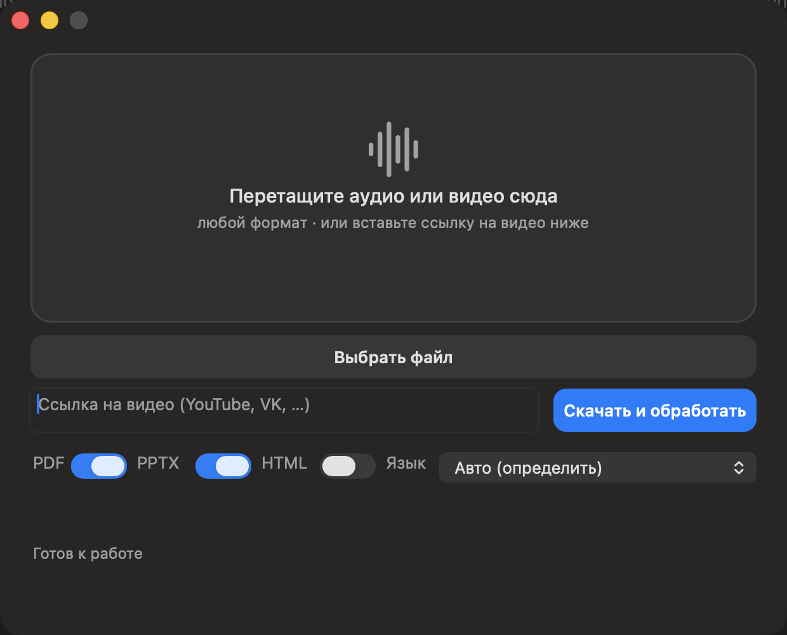

# talking-slides


**Перетащил запись — получил презентацию, которая проигрывает себя.**
Лекция, семинар или ссылка на видео → слайды с тезисами, полный транскрипт
и главы. Полностью локально: записи не покидают компьютер, ключей и
облаков нет.



[English](README.md) | Русский | [Español](README.es.md) | [Deutsch](README.de.md) | [中文](README.zh.md)

## Чем отличается от обёрток над Whisper

- **Слайды проигрывают себя.** У каждого слайда есть таймкоды — и мы
  используем их по-настоящему: PPTX по умолчанию содержит в каждом слайде
  его фрагмент записи (проигрывается прямо в PowerPoint), а офлайн
  HTML-плеер добавляет навигацию по главам с кнопкой ▶ у каждого слайда.
  Клик — и вы слышите исходный момент лекции.
- **Главы для YouTube** — `chapters.txt` в готовом формате описания
  (`00:00 Вступление…`), скопировал — опубликовал.
- **Приватность.** Транскрибация локальной faster-whisper; сетевой доступ
  нужен только чтобы скачать модель при установке или аудио по ссылке,
  которую вы сами дали.

## Возможности

- Вход: аудио в любом формате, который читает ffmpeg (~45 расширений,
  включая звуковые дорожки mp4/mov/mkv), или ссылка на видео
  (YouTube, VK и всё, что поддерживает yt-dlp).
- Выход: PDF, PPTX (со звуком записи в каждом слайде — по умолчанию),
  HTML-плеер, полный транскрипт, главы YouTube.
- Язык: автоопределение или выбор вручную (латиница и кириллица).
- Темы оформления подбираются по содержанию (midnight, ocean, …).
- Нативное macOS-приложение (Swift/AppKit): drag&drop, прогресс по этапам,
  отмена; плюс CLI.

## Быстрый старт

```bash
./install.sh            # venv + зависимости + (по запросу) модель ~1.5 ГБ
./install.sh --app      # то же + сборка Transcriber.app
```

Скрипт спрашивает перед скачиванием модели и не требует ничего сверх
`python3` (3.10+), Homebrew/ffmpeg и ~4 ГБ диска.

### CLI

```bash
.venv/bin/python pipeline.py lecture.m4a --formats pdf,pptx,html
.venv/bin/python pipeline.py https://youtube.com/watch?v=… --lang en --beam 1
```

| Параметр | Значение |
|---|---|
| `--formats pdf,pptx,html,txt` | что рендерить |
| `--no-pptx-audio` | не встраивать звук в PPTX (по умолчанию он встроен) |
| `--lang auto\|ru\|en\|…` | язык записи/вывода |
| `--beam N` | 5 — качество, 1 — в 2–4 раза быстрее |
| `--theme auto\|ИМЯ` | тема оформления слайдов |

### Тесты

```bash
.venv/bin/pip install -r requirements-dev.txt
.venv/bin/python -m pytest tests -q
```

25 офлайн-тестов: правила глав YouTube, safe_stem, эвристика слайдов,
сборка PDF/PPTX/HTML во временную папку (включая проверку встроенного
аудио в PPTX). Модель не нужна.

### Приложение

```bash
./app-sources/build_app.sh                # собрать build/Transcriber.app
cp -R build/Transcriber.app /Applications/
```

Первый запуск: правый клик по приложению → «Открыть» — сборка подписана
ad-hoc, Gatekeeper предупредит. Приложение само находит проект (рядом
с бандлом или `~/audio-transcriber`), путь можно задать переменной
`AUDIO_TRANSCRIBER_DIR`. Кнопки результатов: PDF, PPTX, HTML и «Открыть
папку» — транскрипт и `chapters.txt` открываются из папки результатов.

## Как это работает

1. Аудио декодируется через PyAV/ffmpeg; по ссылке — скачивается yt-dlp.
2. faster-whisper (large-v3-turbo, int8, CPU) транскрибирует с таймкодами.
3. Офлайн-эвристика режет транскрипт на главы по паузам и объёму,
   выбирает тезисы.
4. Рендеры собирают PDF/PPTX/HTML; ffmpeg нарезает фрагменты аудио
   по таймкодам слайдов.

## Требования

- macOS 12+ (CLI работает и на Linux; приложение — только macOS);
- python 3.10+, ffmpeg;
- ~4 ГБ диска: модель 1,5 ГБ + зависимости;
- CPU-only: медленнее не значит хуже — beam 1 даёт приемлемое качество
  в 2–4 раза быстрее.

## Ограничения (честно)

- PPTX со звуком тяжелее: по умолчанию содержит всю запись (~43 МБ на час
  аудио, AAC 96k). Не нужен звук — `--no-pptx-audio`.
- Скорость CPU: beam 5 — примерно 4–5× реального времени (часовая запись
  ≈ 4–5 часов); beam 1 — быстрее, но грубее.
- PDF/PPTX используют Arial: языки на латинице и кириллице; для zh/ja/ar
  нужен другой шрифт и шейпинг — не включено.
- Слайды строит офлайн-эвристика: заголовки — первые предложения глав;
  без LLM. Качество зависит от структуры речи.
- Скачивание видео работает, пока его поддерживают yt-dlp и хостинг.

## Приватность

Транскрибация и рендеры выполняются локально. Из сети при обычной работе
берётся только аудио по ссылке, которую вы явно дали. Записи, транскрипты
и фрагменты остаются на вашей машине.

## Лицензия

MIT — см. [LICENSE](LICENSE).
