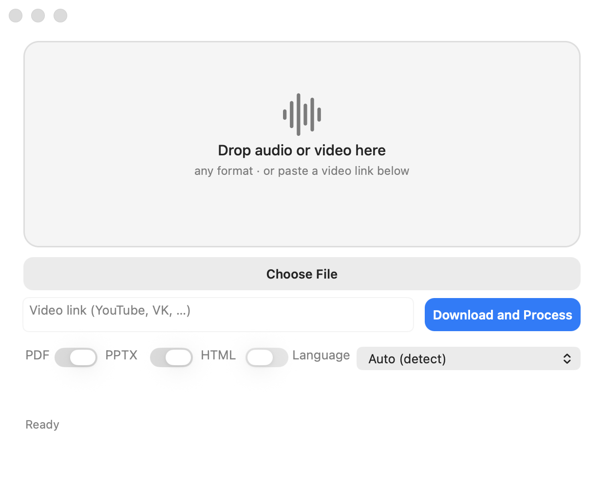

# talking-slides


**拖入一段录音，得到一份会"自己开口讲"的演示文稿。**
课程、研讨会或视频链接 → 带要点的幻灯片、完整逐字稿和章节。完全本地化：
录音永远不会离开你的电脑——无需 API 密钥，不依赖云端。



[English](README.md) | [Русский](README.ru.md) | [Español](README.es.md) | [Deutsch](README.de.md) | 中文

## 与其他 Whisper 封装的不同

- **幻灯片会自己播放。** 每张幻灯片都有时间戳——而且我们真正用上了它们：
  PPTX 默认把每张幻灯片对应的录音片段嵌入其中（直接在 PowerPoint 里播放），
  离线 HTML 播放器还提供章节导航，每张幻灯片带 ▶ 按钮。一点击——就能听到
  课程中的原始片段。
- **YouTube 章节**——`chapters.txt` 采用可直接粘贴到视频简介的格式
  （`00:00 引言…`）。复制、发布，完成。
- **隐私。** 转写使用本地 faster-whisper 模型。网络只在安装时下载模型，
  以及下载你主动提供的视频链接中的音频时才会用到。

## 功能

- 输入：ffmpeg 能读取的任何音频格式（约 45 种扩展名，包括 mp4/mov/mkv
  的音轨），或视频链接（YouTube、VK 以及 yt-dlp 支持的所有站点）。
- 输出：PDF、PPTX（默认在每张幻灯片中嵌入录音）、HTML 播放器、完整逐字稿、
  YouTube 章节。
- 语言：自动检测或手动选择（拉丁与西里尔字母）。
- 幻灯片主题按内容自动匹配（midnight、ocean 等）。
- 原生 macOS 应用（Swift/AppKit）：拖放导入、分阶段进度、可取消；另有
  命令行界面。

## 快速开始

```bash
./install.sh            # venv + 依赖 + （按需）约 1.5 GB 的模型
./install.sh --app      # 同上 + 构建 Transcriber.app
```

脚本在下载模型前会先询问，除 `python3`（3.10+）、Homebrew/ffmpeg 和
约 4 GB 磁盘空间外别无所求。

### 命令行

```bash
.venv/bin/python pipeline.py lecture.m4a --formats pdf,pptx,html
.venv/bin/python pipeline.py https://youtube.com/watch?v=… --lang en --beam 1
```

| 参数 | 说明 |
|---|---|
| `--formats pdf,pptx,html,txt` | 要生成的格式 |
| `--no-pptx-audio` | 不在 PPTX 中嵌入音频（默认嵌入） |
| `--lang auto\|ru\|en\|…` | 录音/输出语言 |
| `--beam N` | 5 — 质量，1 — 快 2–4 倍 |
| `--theme auto\|名称` | 幻灯片主题 |

### 测试

```bash
.venv/bin/pip install -r requirements-dev.txt
.venv/bin/python -m pytest tests -q
```

25 项离线测试：YouTube 章节规则、safe_stem、幻灯片启发式算法、
在临时文件夹中生成 PDF/PPTX/HTML（包括检查 PPTX 中嵌入的音频）。
不需要模型。

### 应用

```bash
./app-sources/build_app.sh                # 构建 build/Transcriber.app
cp -R build/Transcriber.app /Applications/
```

首次运行：右键点击应用 →「打开」——构建采用 ad-hoc 签名，Gatekeeper 会
提示。应用会自动定位项目（与 app 同目录下或 `~/audio-transcriber`），
也可以用 `AUDIO_TRANSCRIBER_DIR` 变量指定路径。结果按钮：PDF、PPTX、
HTML 和「打开文件夹」——逐字稿和 `chapters.txt` 在结果文件夹中打开。

## 工作原理

1. 音频经 PyAV/ffmpeg 解码；链接由 yt-dlp 下载。
2. faster-whisper（large-v3-turbo，int8，CPU）带时间戳转写。
3. 离线启发式算法按停顿和体量把逐字稿切分为章节，并挑出要点。
4. 渲染器生成 PDF/PPTX/HTML；ffmpeg 按幻灯片时间戳切出音频片段。

## 环境要求

- macOS 12+（CLI 也可在 Linux 上运行；应用仅限 macOS）；
- python 3.10+、ffmpeg；
- 约 4 GB 磁盘：1.5 GB 模型 + 依赖；
- 仅 CPU：慢不等于差——beam 1 以 2–4 倍速度提供可接受的质量。

## 坦率的局限

- 带声音的 PPTX 更大：默认包含整段录音（每小时音频约 43 MB，AAC 96k）。
  不需要声音？用 `--no-pptx-audio`。
- CPU 速度：beam 5 约为实时的 4–5 倍（一小时录音约需 4–5 小时）；
  beam 1 更快但更粗糙。
- PDF/PPTX 使用 Arial：支持拉丁和西里尔字母语言；zh/ja/ar 需要其他字体
  和文字整形——暂未包含。
- 幻灯片由离线启发式算法生成：标题取自各章节的前几句；不使用 LLM。
  质量取决于讲话的结构。
- 链接下载能否使用取决于 yt-dlp 和各平台的支持情况。

## 隐私

转写和生成全部在本地完成。正常使用时，网络流量只有你明确以链接形式提供
的音频。录音、逐字稿和音频片段都保留在你自己的电脑上。

## 许可证

MIT —— 见 [LICENSE](LICENSE)。
